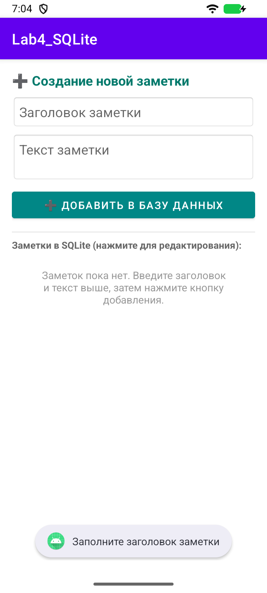
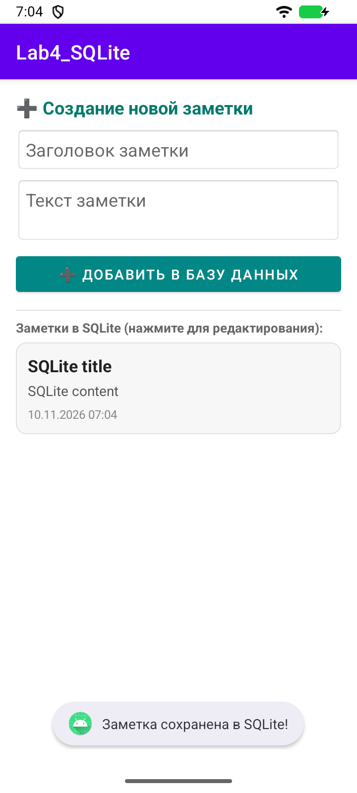
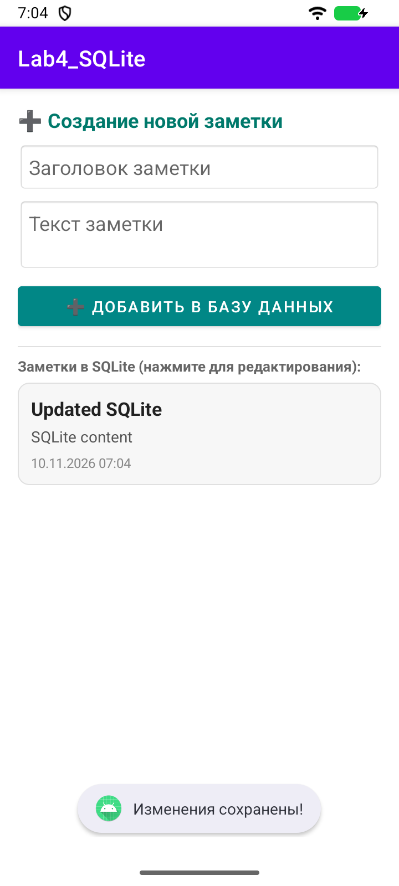
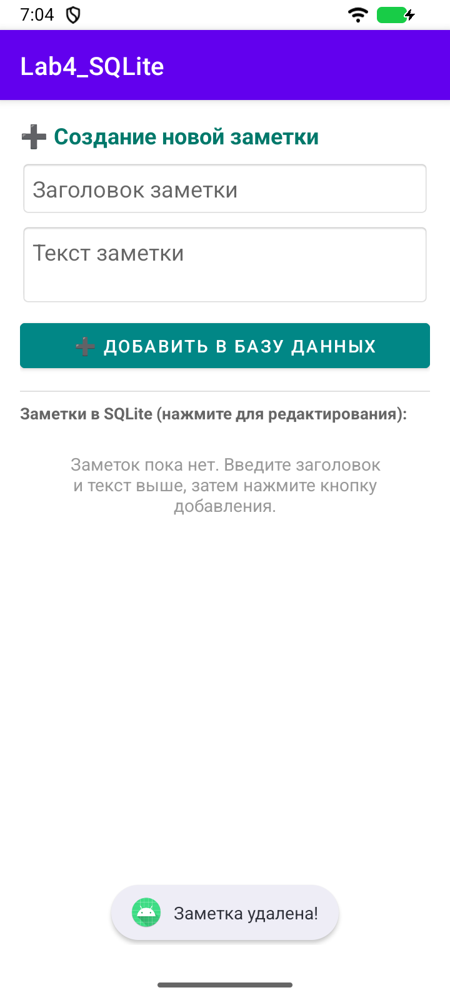

# Лабораторная работа 4

## Прямая работа со SQLite

Студент: Ретунский Савелий. Проверка: 10 ноября 2026 года.

## Цель

Реализовать CRUD без Room, обработку Cursor и выполнение запросов вне главного потока.

## Структура

MainActivity → lifecycleScope / Dispatchers.IO → NotesDbHelper → SQLite → Cursor.use → List<Note> → главный поток → NotesAdapter → RecyclerView.

## Реализация и исправления

1. NotesDbHelper наследует SQLiteOpenHelper. Таблица notes содержит id INTEGER PRIMARY KEY AUTOINCREMENT, title, content, timestamp. onCreate создаёт таблицу, onUpgrade пересоздаёт её для учебной версии схемы.

2. insertNote возвращает ID, getAllNotes читает Cursor через getColumnIndexOrThrow, updateNote и deleteNote используют условие id = ? и аргументы. Вставка проверяет -1, обновление/удаление — число изменённых строк.

3. Cursor закрывается через use. Операции helper синхронизированы; соединение закрывается в finally после каждой операции. SQLiteDatabase не хранится полем класса.

4. Запросы выполняются на Dispatchers.IO, обновление списка — в главном потоке. Добавлена обработка исключений БД с Toast. Заголовок валидируется до запроса.

5. Выбор карточки включает редактирование; изменение и удаление работают по сохранённому ID. Выбранный ID и введённый текст сохраняются при повороте. Форма и список доступны через прокрутку.

## Проверка

Сборка `assembleDebug assembleDebugAndroidTest lintDebug`: успешно. Android Lint: 0 ошибок, 40 предупреждений. Предупреждения включают строки в XML вместо ресурсов, локализацию и рекомендации по зависимостям; они не скрыты baseline-файлом.

Эмулятор: Medium Phone, Android 16 API 36.1, x86_64. Тест `LabRegressionTest`: пройден. Исходник теста: [LabRegressionTest.kt](../app/src/androidTest/java/com/example/lab4_sqlite/LabRegressionTest.kt).

`connectedDebugAndroidTest` в этой Windows-среде не запустил Gradle Worker (`GradleWorkerMain` не найден). Те же собранные тестовые APK запускались через `adb shell am instrument -w …/androidx.test.runner.AndroidJUnitRunner`. Для повторения: `./verify.ps1 -DeviceTests` на отдельном эмуляторе. Скрипт очищает учебные данные приложения на эмуляторе.

Лог запуска:

```text
com.example.lab4_sqlite.LabRegressionTest:.

Time: 25.639

OK (1 test)
```

В текущей реализации тела четырёх CRUD-методов SQLite занимают 69 строк (с объявлениями методов и закрытием ресурсов). Полный DAO Room из соседней работы — 24 строк (с package/import/аннотациями и наблюдаемым запросом). Это сравнение конкретных исходников, без UI и сгенерированного кода Room.

## Скриншоты сценариев

### 01-empty-title



### 02-inserted



### 03-updated



### 04-deleted



## Фрагменты кода

### NotesDbHelper.kt

[Полный исходник](../app/src/main/java/com/example/lab4_sqlite/NotesDbHelper.kt)

```kotlin
class NotesDbHelper(context: Context) : SQLiteOpenHelper(context, DATABASE_NAME, null, DATABASE_VERSION) {

    companion object {
        private const val DATABASE_NAME = "notes.db"
        private const val DATABASE_VERSION = 1

        const val TABLE_NAME = "notes"
        const val COLUMN_ID = "id"
        const val COLUMN_TITLE = "title"
        const val COLUMN_CONTENT = "content"
        const val COLUMN_TIMESTAMP = "timestamp"
    }

    override fun onCreate(db: SQLiteDatabase) {
        val createTableQuery = """
            CREATE TABLE $TABLE_NAME (
                $COLUMN_ID INTEGER PRIMARY KEY AUTOINCREMENT,
                $COLUMN_TITLE TEXT NOT NULL,
                $COLUMN_CONTENT TEXT,
                $COLUMN_TIMESTAMP INTEGER
            )
        """.trimIndent()
        db.execSQL(createTableQuery)
    }

    override fun onUpgrade(db: SQLiteDatabase, oldVersion: Int, newVersion: Int) {
        db.execSQL("DROP TABLE IF EXISTS $TABLE_NAME")
        onCreate(db)
    }

    // Создание заметки (Insert)
    @Synchronized
    fun insertNote(title: String, content: String): Long {
        try {
            val db = writableDatabase
            val values = ContentValues().apply {
                put(COLUMN_TITLE, title)
                put(COLUMN_CONTENT, content)
                put(COLUMN_TIMESTAMP, System.currentTimeMillis())
            }
            return db.insert(TABLE_NAME, null, values)
        } finally {
            close()
        }
    }

    // Получение всех заметок (Read)
    @Synchronized
    fun getAllNotes(): List<Note> {
        try {
            val notesList = mutableListOf<Note>()
            val db = readableDatabase
            val cursor = db.query(
                TABLE_NAME,
                null,
                null,
                null,
                null,
                null,
                "$COLUMN_TIMESTAMP DESC"
            )

            cursor.use { c ->
                val idIndex = c.getColumnIndexOrThrow(COLUMN_ID)
                val titleIndex = c.getColumnIndexOrThrow(COLUMN_TITLE)
                val contentIndex = c.getColumnIndexOrThrow(COLUMN_CONTENT)
                val timestampIndex = c.getColumnIndexOrThrow(COLUMN_TIMESTAMP)

                while (c.moveToNext()) {
                    val note = Note(
                        id = c.getLong(idIndex),
                        title = c.getString(titleIndex),
                        content = c.getString(contentIndex) ?: "",
                        timestamp = c.getLong(timestampIndex)
                    )
                    notesList.add(note)
                }
            }
            return notesList
        } finally {
            close()
        }
    }

    // Обновление заметки (Update)
    @Synchronized
    fun updateNote(id: Long, title: String, content: String): Int {
        try {
            val db = writableDatabase
            val values = ContentValues().apply {
                put(COLUMN_TITLE, title)
                put(COLUMN_CONTENT, content)
                put(COLUMN_TIMESTAMP, System.currentTimeMillis())
            }
            return db.update(TABLE_NAME, values, "$COLUMN_ID = ?", arrayOf(id.toString()))
        } finally {
            close()
        }
    }

    // Удаление заметки (Delete)
    @Synchronized
    fun deleteNote(id: Long): Int {
        try {
            val db = writableDatabase
            return db.delete(TABLE_NAME, "$COLUMN_ID = ?", arrayOf(id.toString()))
        } finally {
            close()
        }
    }
}
```

### MainActivity.kt

[Полный исходник](../app/src/main/java/com/example/lab4_sqlite/MainActivity.kt)

```kotlin
private fun loadNotes() {
        lifecycleScope.launch(Dispatchers.IO + databaseErrors) {
            val notes = dbHelper.getAllNotes()
            withContext(Dispatchers.Main) {
                adapter.updateData(notes)
                if (notes.isEmpty()) {
                    tvEmptyState.visibility = View.VISIBLE
                    recyclerView.visibility = View.GONE
                } else {
                    tvEmptyState.visibility = View.GONE
                    recyclerView.visibility = View.VISIBLE
                }
            }
        }
    }
```

### NotesAdapter.kt

[Полный исходник](../app/src/main/java/com/example/lab4_sqlite/NotesAdapter.kt)

```kotlin
class NotesAdapter(
    private var notes: List<Note>,
    private val onNoteClick: (Note) -> Unit
) : RecyclerView.Adapter<NotesAdapter.NoteViewHolder>() {

    private val dateFormat = SimpleDateFormat("dd.MM.yyyy HH:mm", Locale.getDefault())
    private var selectedId: Long? = null

    inner class NoteViewHolder(itemView: View) : RecyclerView.ViewHolder(itemView) {
        val container: LinearLayout = itemView.findViewById(R.id.cardContainer)
        val tvTitle: TextView = itemView.findViewById(R.id.tvNoteTitle)
        val tvContent: TextView = itemView.findViewById(R.id.tvNoteContent)
        val tvDate: TextView = itemView.findViewById(R.id.tvNoteDate)
        val tvSelectHint: TextView = itemView.findViewById(R.id.tvSelectHint)
    }

    override fun onCreateViewHolder(parent: ViewGroup, viewType: Int): NoteViewHolder {
        val view = LayoutInflater.from(parent.context)
            .inflate(R.layout.item_note_sqlite, parent, false)
        return NoteViewHolder(view)
    }

    override fun onBindViewHolder(holder: NoteViewHolder, position: Int) {
        val note = notes[position]
        holder.tvTitle.text = note.title
        holder.tvContent.text = note.content
        holder.tvDate.text = dateFormat.format(Date(note.timestamp))

        val isSelected = (note.id == selectedId)
        if (isSelected) {
            holder.container.setBackgroundResource(R.drawable.bg_card_selected)
            holder.tvSelectHint.visibility = View.VISIBLE
        } else {
            holder.container.setBackgroundResource(R.drawable.bg_card_normal)
            holder.tvSelectHint.visibility = View.GONE
        }

        holder.itemView.setOnClickListener {
            onNoteClick(note)
        }
    }

    override fun getItemCount(): Int = notes.size

    fun updateData(newNotes: List<Note>) {
        this.notes = newNotes
        notifyDataSetChanged()
    }

    fun setSelectedId(id: Long?) {
        this.selectedId = id
        notifyDataSetChanged()
    }
}
```

## Вывод

Прямая SQLite даёт полный контроль над SQL, Cursor и временем жизни соединения. Цена — ручное преобразование строк, больше кода и риск утечек/ошибок колонок. Room оставляет SQLite в основе, но генерирует преобразования и проверяет запросы при компиляции. Сценарий onUpgrade с удалением таблицы допустим только для этой учебной схемы; он не сохраняет данные при повышении версии.
